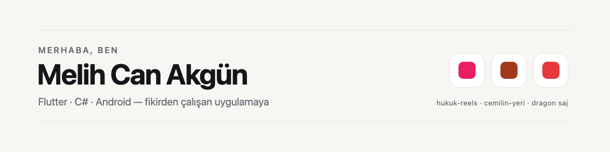

<picture>
  <source media="(prefers-color-scheme: dark)" srcset="assets/profil-banner-koyu.png">
  
</picture>

# 

- **Mobil ve web:** Flutter/Dart ile PWA, Kotlin ile Android
- **Masaüstü:** C# / .NET, Windows Forms, donanım sensörleri
- **Küçük backend'ler:** Cloudflare Workers + D1, Web Push

---

## Öne çıkan projeler

### [Hukuk Reels](https://github.com/MelihCanAkgun/hukuk-reels) · [Canlı demo](https://melihcanakgun.github.io/hukuk-reels/)
**Hukuk öğrenimini kısa, oyunlaştırılmış oturumlara dönüştüren, çevrimdışı çalışan Flutter PWA.**
Ders özetleri (iPad + Apple Pencil için not modu), soru bankası, mini oyunlar ve iki kişilik skor tablosu. Özel service worker ile ilk yüklemeden sonra internetsiz açılır; skor ve bildirimler için Cloudflare Workers + D1 üzerinde küçük bir API kullanır.
`Flutter` `Dart` `PWA` `Service Worker` `Cloudflare Workers` `D1` `Web Push`

### [Dragon Saj — Sıcaklık Paneli](https://github.com/MelihCanAkgun/SicaklikPaneli)
**Windows için hafif CPU/GPU sıcaklık izleyicisi ve oyun içi gösterge.**
Görev çubuğunda canlı sıcaklık, son 3 dakikanın grafiği, tam ekran oyunlarda otomatik açılan overlay (RTSS desteğiyle), ısıl kısıtlama uyarısı; MSI dizüstülerde fan eğrisi ve performans modu, NVIDIA kartlarda sınırlı hız aşırtma.
`C#` `.NET 9` `Windows Forms` `LibreHardwareMonitor`

### [Cemil'in Yeri — İndirme sayfası](https://github.com/MelihCanAkgun/cemilin-yeri-indir) · [Sayfayı aç](https://melihcanakgun.github.io/cemilin-yeri-indir/)
**Geliştirdiğim Android veresiye defteri uygulamasının dağıtım sayfası.**
Play Store dışından kurulumu adım adım anlatan, sürüm notlarını ve QR kodu içeren, açık/koyu temalı tek sayfalık site. Uygulamanın kendisi Kotlin ile yazıldı.
`Kotlin` `Android` `HTML` `CSS` `GitHub Pages`

<b>Diğer çalışmalar — üniversite ders projeleri</b>

- [**calc-version4**](https://github.com/MelihCanAkgun/calc-version4) — C# / Windows Forms hesap makinesi, ders projesinin geliştirilmiş sürümü (.NET 8).
- [**Hesap-makinesi-proje-1**](https://github.com/MelihCanAkgun/Hesap-makinesi-proje-1) — Aynı projenin ilk sürümü (.NET Framework 4.7.2); olay odaklı programlamaya ilk adımlarım.

---

## Teknolojiler

| Alan | Kullandıklarım |
| :--- | :--- |
| Mobil & web | Flutter, Dart, PWA, service worker, çevrimdışı önbellekleme |
| Android | Kotlin |
| Masaüstü | C#, .NET, Windows Forms |
| Backend | Cloudflare Workers, D1 (SQLite), Web Push |
| Araçlar | Git, GitHub Pages |

---

## İletişim

Projelerle ilgili geri bildirim ve önerilere açığım; bir issue açmaktan çekinme.
