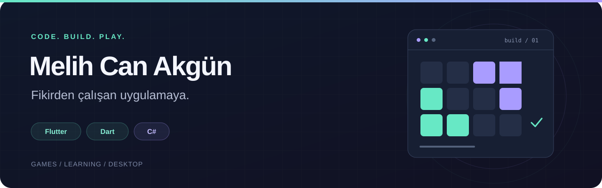

  

<h1 align="center">Merhaba, ben Melih </h1>

  Flutter/Dart ve C# ile <b>oyunlar, öğrenme araçları ve masaüstü uygulamaları</b> geliştiriyorum. 
  Burada fikirlerimin çalışan hâllerini ve gelişim süreçlerini bulabilirsin.

  <a href="#öne-çıkan-projeler">Projeleri keşfet</a> ·
  <a href="#kullandığım-teknolojiler">Teknolojiler</a> ·
  <a href="https://github.com/MelihCanAkgun?tab=repositories">Tüm depolar</a>

---

## Öne çıkan projeler

### 🧮 [Calculator · v4](https://github.com/MelihCanAkgun/calc-version4)

**C# ile masaüstü uygulama geliştirme.**

İzmir Bakırçay Üniversitesi ders projesi kapsamında geliştirdiğim Windows Forms hesap makinesi. Arayüz tasarımı ve olay odaklı programlama çalışmalarımı içeriyor.

`C#` `Windows Forms` `Masaüstü`

  
İlk sürüme de göz at

  [Hesap Makinesi · Proje 1](https://github.com/MelihCanAkgun/Hesap-makinesi-proje-1), hesap makinesi çalışmalarımın ilk deposu.

## Kullandığım teknolojiler

| Alan | Projelerimde kullandıklarım |
| :--- | :--- |
| Uygulama ve oyun | Flutter · Dart |
| Masaüstü | C# · Windows Forms |
| Web deneyimi | PWA · Çevrimdışı önbellekleme · Yerel depolama |

---

  <b>Kodu keşfet, fikrin varsa bir issue aç.</b> 
  Projelere dair geri bildirim ve önerilere açığım.

